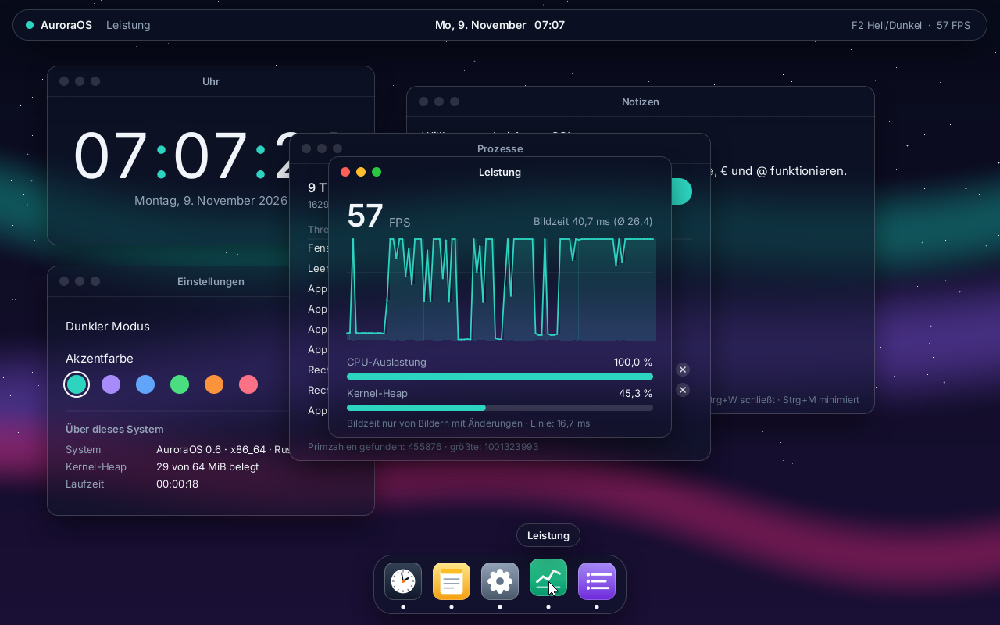
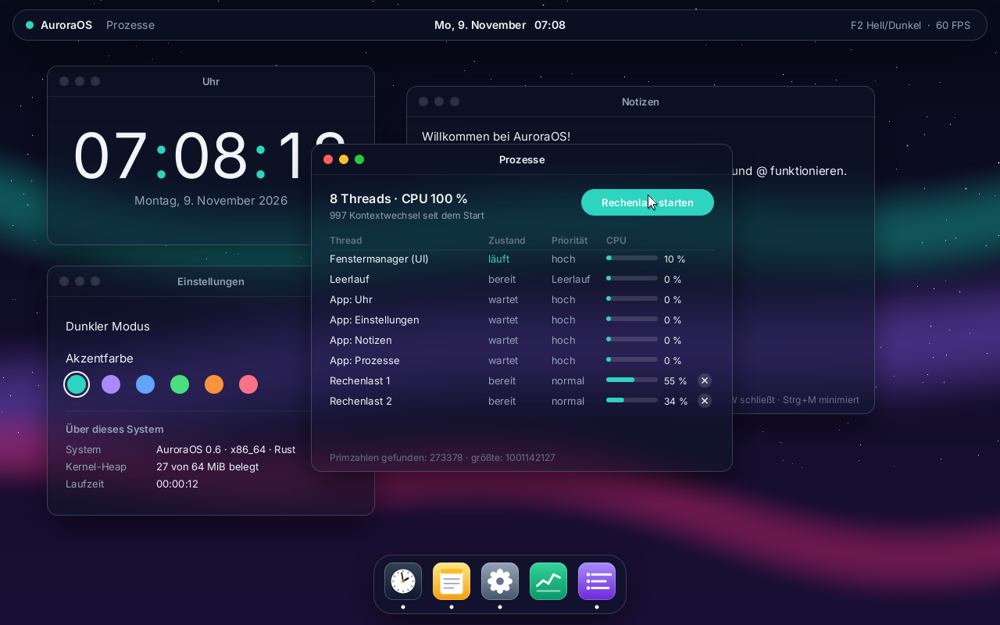
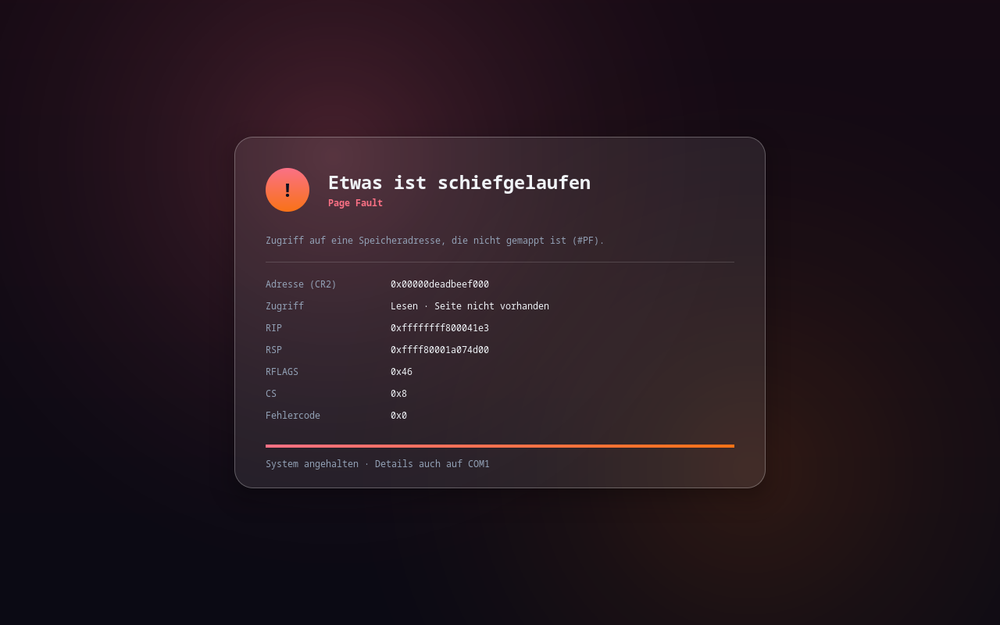

# AuroraOS

Ein modernes Hobby-Betriebssystem in Rust (x86_64, UEFI, Limine).

**Stand:** Meilensteine 1–7 fertig: Booten, Exceptions, Speicherverwaltung,
Timer/Tastatur/Maus, Compositor mit Glas-Blur und Vektorschrift, Fenstersystem
mit Dock und präemptives Multitasking (jede App rendert in ihrem eigenen Thread,
Task-Manager „Prozesse“, Thread-Stacks mit Guard-Page).







## Bauen (WSL2 / Ubuntu)

```bash
sudo apt install build-essential git xorriso qemu-system-x86 ovmf gdb
curl --proto '=https' --tlsv1.2 -sSf https://sh.rustup.rs | sh
make        # baut build/aurora.iso
make run    # startet in QEMU (UEFI)
make debug  # QEMU wartet auf GDB an Port 1234
```

## Starten unter Windows

* **QEMU nativ:** `.\run.ps1` in PowerShell – zum Benutzen der Maus ins Fenster klicken, freigeben mit **Strg+Alt+G**
* **VirtualBox:** neue VM „Other/Unknown (64-bit)“, *EFI aktivieren*, `build\aurora.iso` als DVD einlegen
* **USB-Stick:** ISO mit Rufus im **DD-Modus** schreiben (bootet per UEFI und BIOS)

## Bedienung

| Aktion | So geht's |
|---|---|
| Fenster verschieben | an der Titelleiste ziehen |
| Größe ändern | an Rand oder Ecke ziehen |
| Andocken | Fenster an den linken/rechten Rand ziehen (halber Bildschirm), nach oben = maximieren |
| Schließen / Minimieren / Maximieren | rote / gelbe / grüne Punkte, oder **Strg+W** / **Strg+M** / **F11** |
| Apps öffnen | Symbol im Dock anklicken (nochmal = minimieren) |
| Hell/Dunkel | Schalter in den Einstellungen oder **F2** |
| Akzentfarbe | Farbtupfer in den Einstellungen oder dort scrollen |
| Lasttest | in „Prozesse“ auf „Rechenlast starten“, mit × wieder beenden |

## Struktur

```
aurora-os/
├─ Makefile            Build-System (Kernel -> ISO -> QEMU)
├─ limine.conf         Bootmenü-Konfiguration
├─ run.ps1             QEMU-Start unter Windows
└─ kernel/
   ├─ Cargo.toml
   ├─ rust-toolchain.toml   Rust nightly + rust-src
   ├─ x86_64-aurora.json    eigenes Target (Bare Metal mit SSE)
   ├─ .cargo/config.toml    Target & build-std
   ├─ fonts/                Inter (Vektorschrift) + Lizenz
   ├─ build.rs              bindet linker.ld ein
   ├─ linker.ld             Speicherlayout (Higher Half)
   └─ src/
      ├─ entry.rs           Einstieg _start: SSE einschalten
      ├─ main.rs            Einstieg kmain(), Limine-Requests, Absturz-Tests
      ├─ gdt.rs             GDT + TSS (Ersatz-Stack für Double Faults)
      ├─ interrupts.rs      IDT + Exception-Handler
      ├─ memory.rs          Speicherkarte, Frame-Allocator, Paging
      ├─ allocator.rs       Kernel-Heap (16 MiB)
      ├─ selftest.rs        Selbsttests beim Start
      ├─ acpi.rs            ACPI-Tabellen (MADT)
      ├─ apic.rs            Local APIC, I/O APIC, Timer
      ├─ ps2.rs             PS/2-Controller, Maus-Pakete
      ├─ ringbuf.rs         Ringpuffer ohne Sperren
      ├─ time.rs            Ticks, Uhrzeit, Datum
      ├─ io.rs              I/O-Ports
      ├─ desktop.rs         Fenstermanager, Dock, Menüleiste, Eingaben
      ├─ apps.rs            Apps (Uhr, Notizen, Einstellungen, Leistung, Prozesse)
      ├─ appthread.rs       ein Render-Thread pro App, Austausch per Briefkasten
      ├─ task.rs            Threads, präemptiver Scheduler, Kontextwechsel
      ├─ workers.rs         Rechen-Threads (Primzahlen) für den Lasttest
      ├─ compositor.rs      Ebenen, Schatten, Glas-Blur, Damage-Tracking
      ├─ paint.rs           Zeichnen mit Alphakanal (Gleitkomma/SSE)
      ├─ font.rs            Vektorschrift Inter (fontdue) + Glyphen-Cache
      ├─ wallpaper.rs       Hintergrundbild + Weichzeichner
      ├─ theme.rs           Farbpaletten Hell/Dunkel, Akzentfarben
      ├─ anim.rs            Easing-Kurven, Tweens
      ├─ screens.rs         Start- und Fehlerbildschirm
      ├─ framebuffer.rs     globaler Bildschirmzugriff
      ├─ gfx.rs             einfache Grafik für Start- und Fehlerbildschirm
      ├─ fmtbuf.rs          fmt!-Makro ohne Heap
      └─ serial.rs          COM1-Debug-Ausgabe
```
